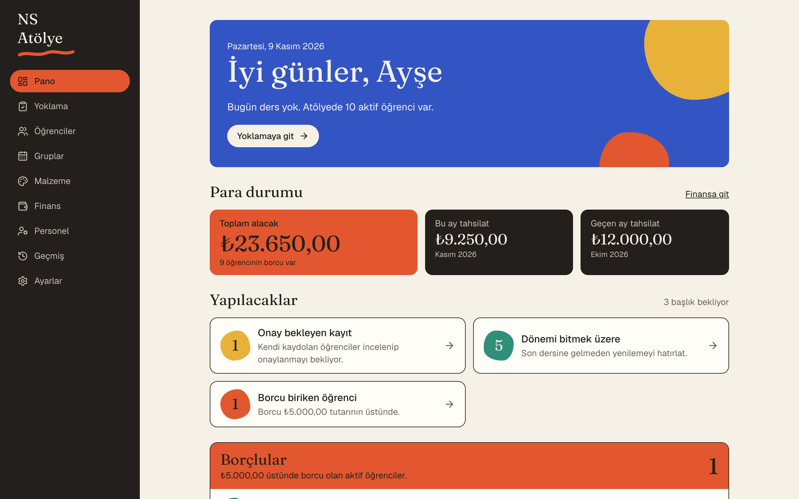
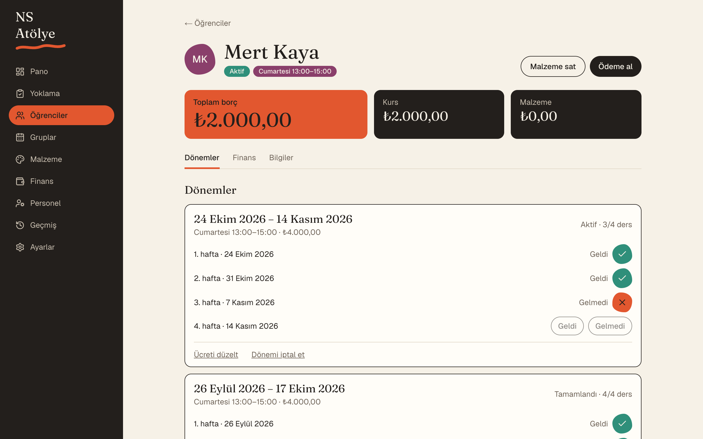
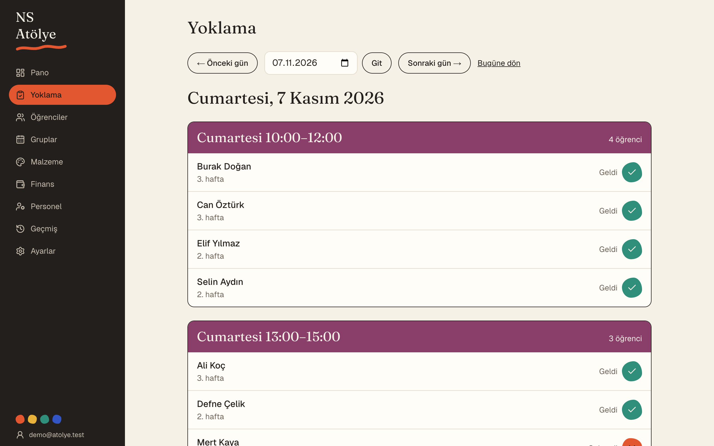
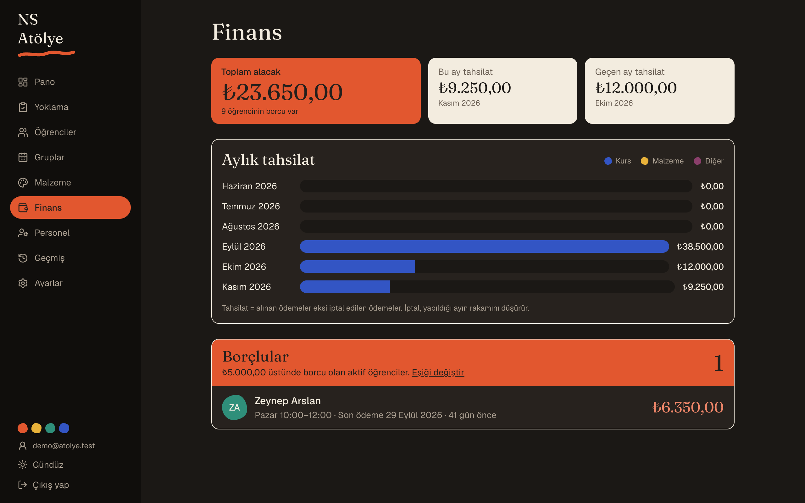
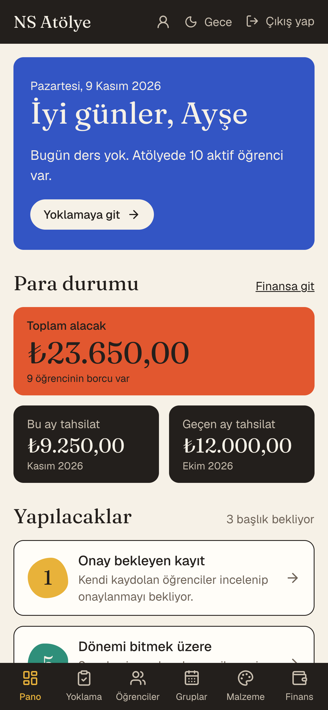

# NS Atölye

I built this for my mom's painting workshop. It keeps students, weekly lessons, attendance, monthly fees, payments and material sales in one place, so she can spend less time on paperwork and more time painting with her students.
It is live at **[nsatolye.com](https://nsatolye.com)** and is a rebuilt version of my earlier PHP project, [NSWorkshop](https://github.com/aserhatsahin/NSWorkshop).



<sub>All screenshots use made-up demo data.</sub>

## What it does

- **Three roles, three panels.** The workshop owner sees everything, including income and debts. Staff handle students, attendance and payments but cannot see the workshop's overall finances. Students get their own panel with their lessons and balance.
- **Lesson periods and attendance.** A period is four weekly lessons in the student's group. Staff mark each lesson as attended or missed, and a period completes once all four are marked.
- **Fees, payments and materials.** Opening a period charges its fee, payments are split between course and material debt, and paint or canvas sold in the workshop is added to the student's balance.
- **A dashboard with to-dos.** Today's lessons, unmarked attendance, periods about to end, and for the owner, the students with the highest debt and when they last paid.
- **Light and dark themes** and a layout that also works on a phone.

| Student detail | Attendance |
|---|---|
|  |  |

| Finance (dark theme) | On a phone |
|---|---|
|  |  |

## How it's built

**Stack:** Next.js 16 (App Router), TypeScript, PostgreSQL, Prisma 7, Auth.js v5, Tailwind CSS 4, Zod, Vitest. Hosted on Vercel with the database on Neon.

A few decisions that shape the code:

- **Balances are never stored.** A student's debt is always calculated from an append-only ledger of financial transactions. Mistakes are fixed with a reversing entry, never by editing or deleting a record.
- **Money is stored as integer kuruş**, so there are no floating-point rounding errors.
- **Permissions are checked in the service layer**, not only in the UI or middleware. The user's role is read from the database on every request, so a role change takes effect immediately.
- **Multi-record operations run in a single transaction** with row locks, so two staff members recording a payment for the same student at the same time cannot corrupt the balance.
- **Every change is written to an audit log** that the owner can browse.

The business rules that are easy to get wrong (debt calculation, splitting a payment, cancelling a period halfway through, permission checks) are covered by Vitest tests.

## Running locally

```bash
npm install
cp .env.example .env        # fill in DATABASE_URL, AUTH_SECRET and the seed owner
npx prisma dev -n nsworkshop -d   # local Postgres; put its URL in DATABASE_URL
npx prisma migrate deploy
npm run db:seed             # creates the owner account (+ sample groups if SEED_SAMPLE_DATA=true)
npm run dev
```

## License

MIT
